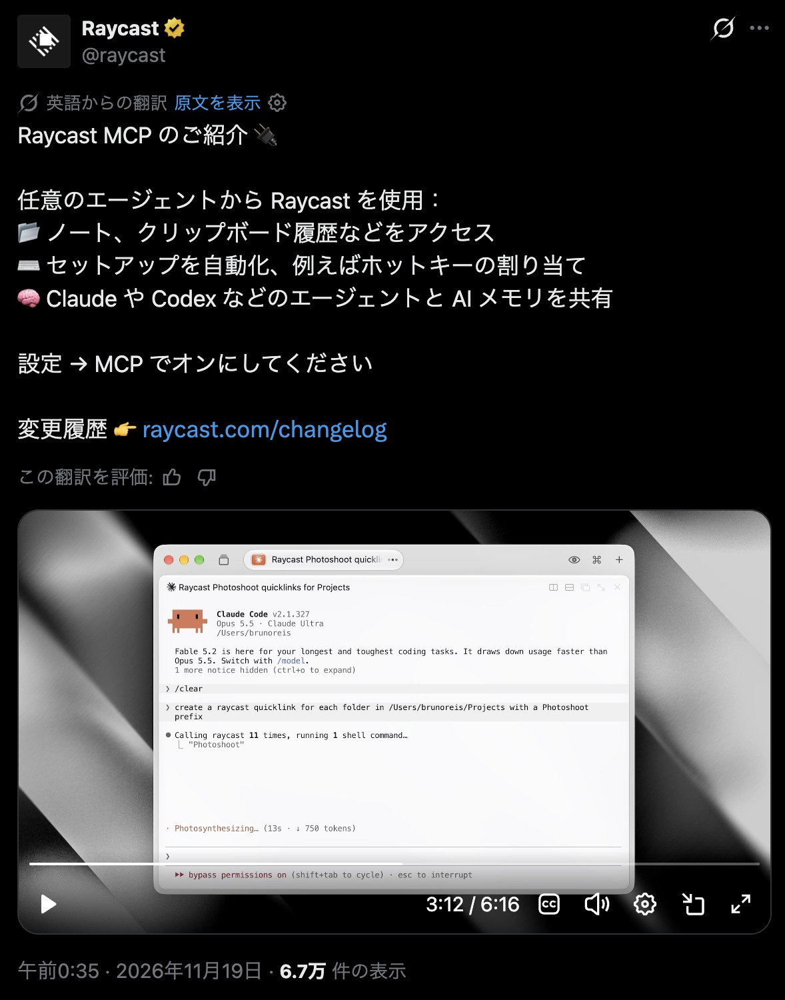
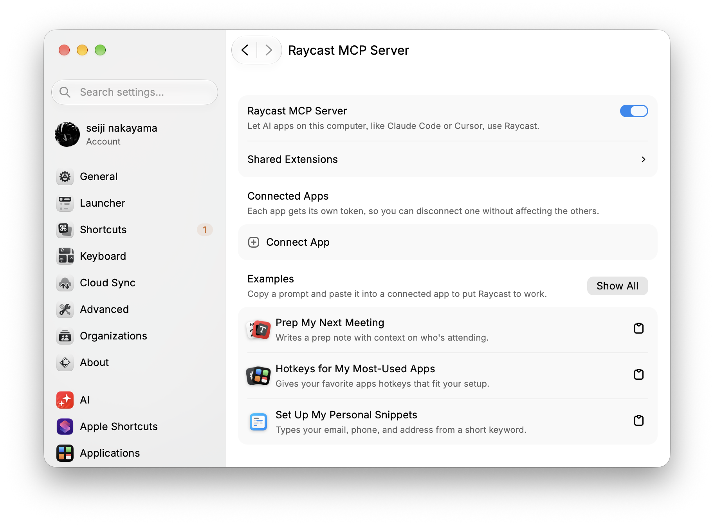
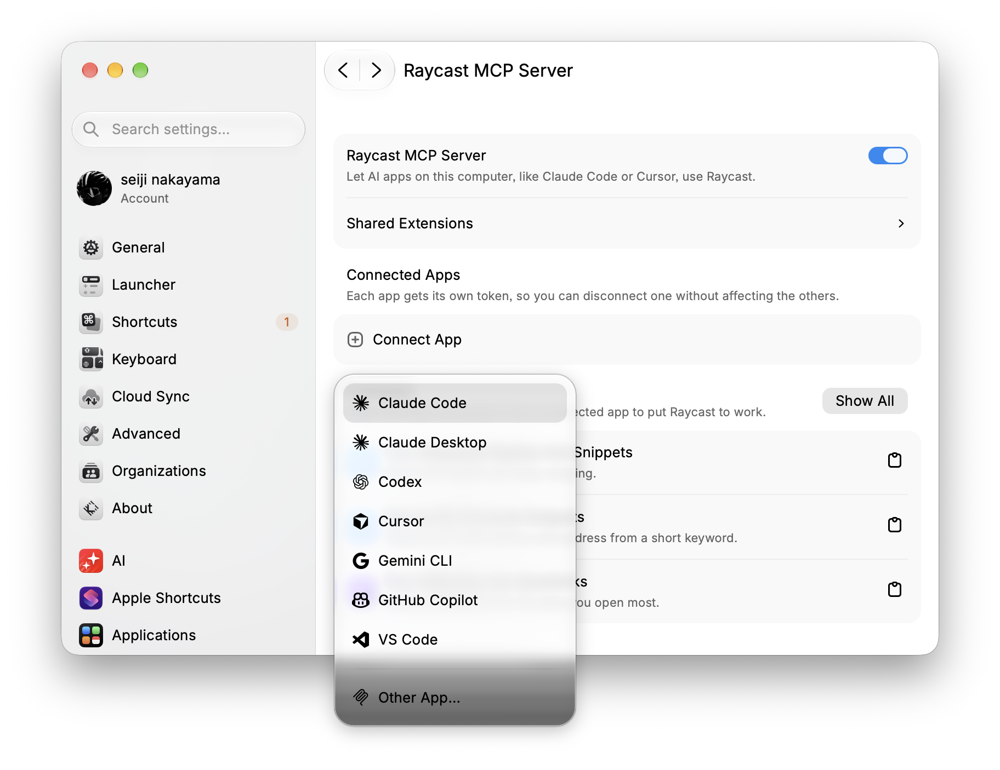
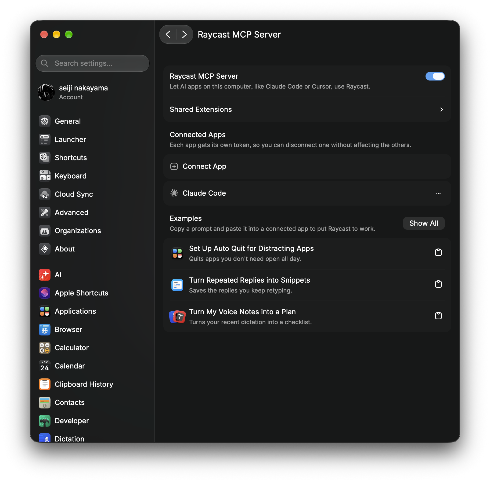
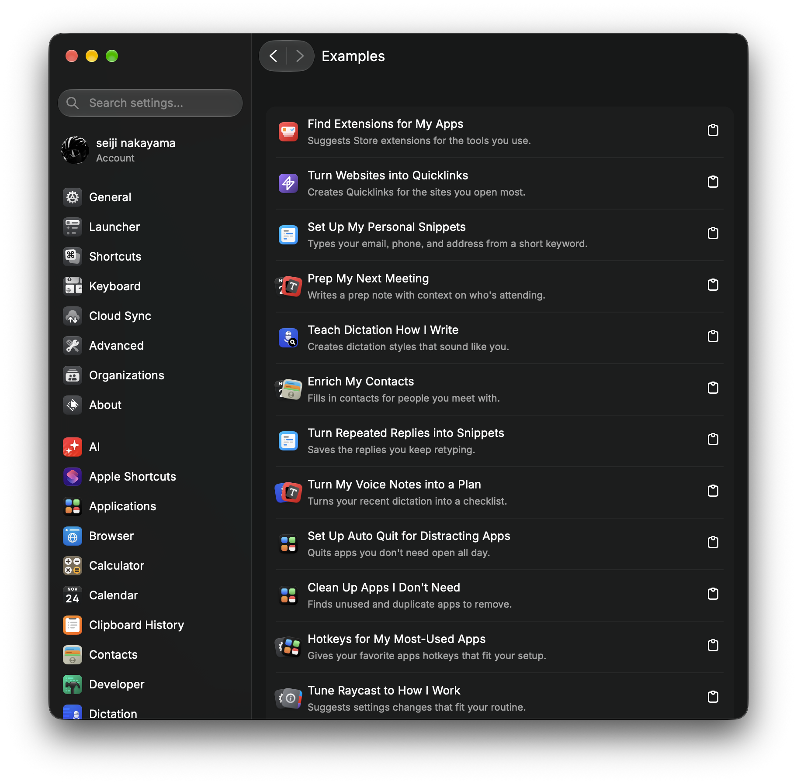
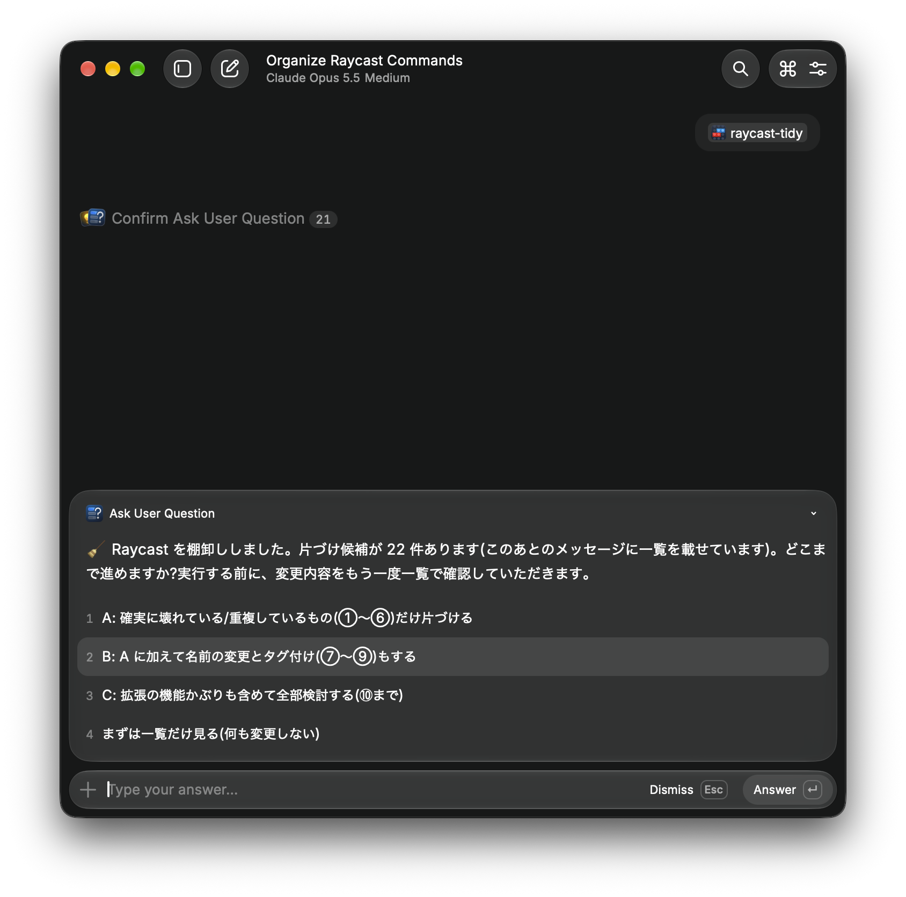
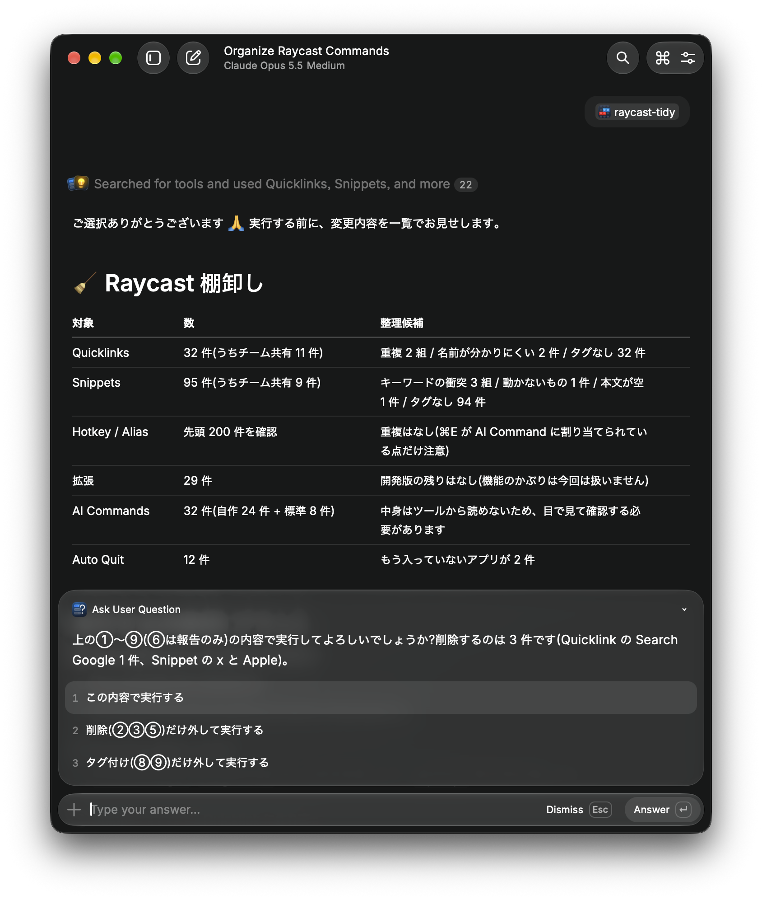
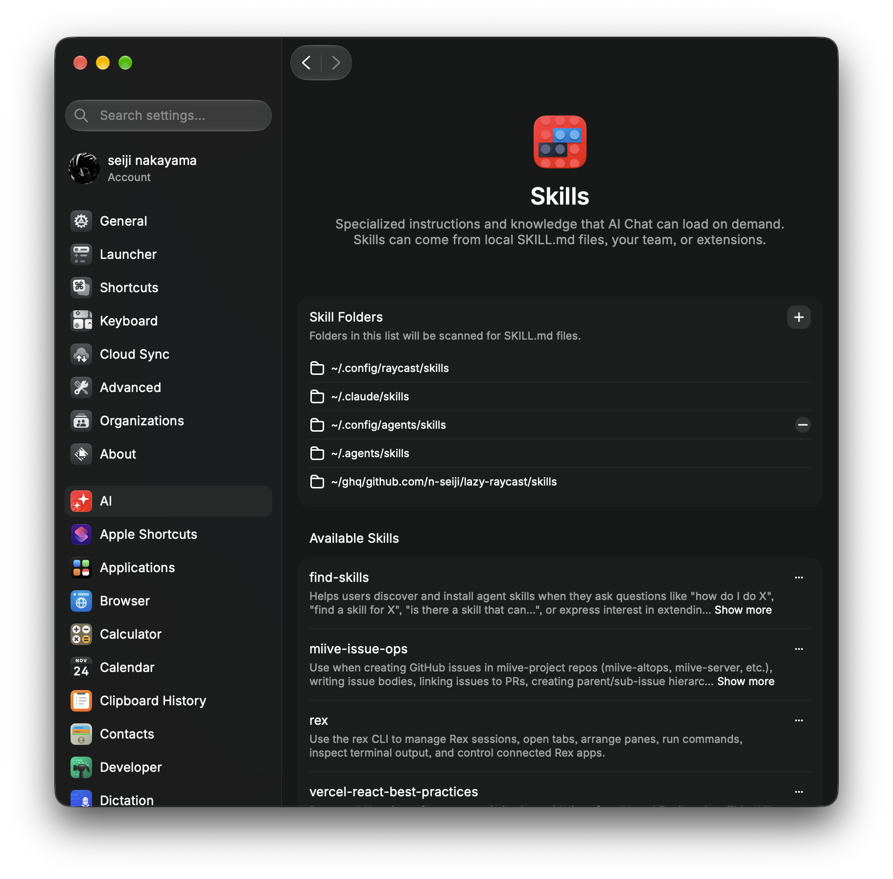
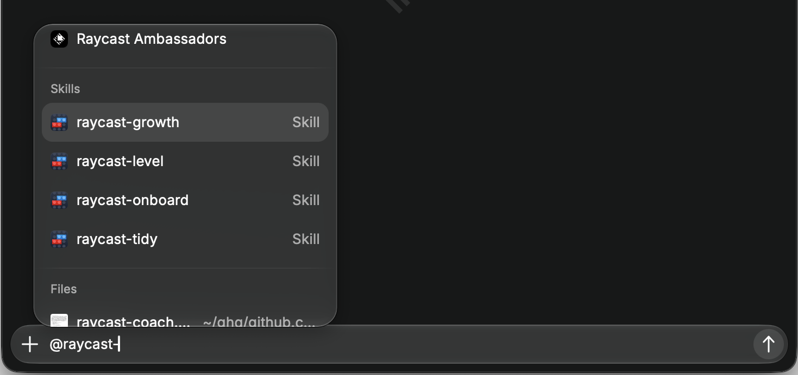

<script src="https://cdn.tailwindcss.com/3.4.4"></script>
<script>tailwind.config = { corePlugins: { preflight: false } }</script>

<style>
:root {
  --color-primary: #ff6362;
}
/* 明るい面(引用・コードブロック)の上は濃い文字にする */
section blockquote,
section marp-pre,
section code[class^="language-"] {
  color: #33302a;
}
section table td:first-child {
  white-space: nowrap;
}
section blockquote .ja {
  display: block;
  margin-top: 0.4em;
  font-size: 85%;
  color: #6b675e;
}
</style>

<!-- _class: slide-title -->

<div class="title">
  <div>Raycast MCP Server</div>
</div>
<div class="name">Seiji Nakayama</div>
<div class="date-and-event">2026/11/24 Raycast Meetup Japan #3</div>

---

<!-- _class: full lead narration-white -->



# Raycast<br>MCP Server が来た!

###### 元々 [Raycast → MCP](https://n-seiji.github.io/slides/ai-dev-day/) はあった。<br>今回は MCP → Raycast にアクセスできるように

<div class="text-6xl mt-10 text-center">👉 👉 👉 👉</div>

---


<style scoped>
.item {
  display: flex;
  align-items: center;
  gap: 0.75em;
}
</style>

<div>
  <h1 class="text-foreground">
    せーじ
    <small class="text-3xl font-bold">(Seiji Nakayama)</small>
  </h1>
  <h5 class="text-dimmed">ただのVimmer</h5>
  <div class="mt-12 space-y-2 text-2xl">
    <div class="item">
      <div class="label">業務</div>
      <span><small>バックエンド・Webの開発(たまにアプリ)</small></span>
    </div>
    <div class="item">
      <div class="label">好き</div>
      <span>
        Raycast・Vim・ロードバイク・車<br />
        <strong>シンプルで拡張性があるプロダクト</strong>
      </span>
    </div>
    <div class="item">
      <div class="label">特徴</div>
      <span>実家が洋菓子店</span>
    </div>
    <div class="item">
      <div class="label">サイト</div>
      <a href="https://sijis.me"><small>HomePage</small></a>
      <a href="https://www.raycast.com/n_seiji"><small>Raycast</small></a>
      <a href="https://github.com/n-seiji"><small>GitHub</small></a>
      <a href="https://x.com/se_eiji"><small>X</small></a>
    </div>
  </div>
</div>

---

## miive は福利厚生カードを作っています

<style scoped>
/* 会社紹介だけ miive カラー */
section {
  --color-primary: #61ccbe;
}
</style>

<div class='mt-2 text-2xl'>

「今の福利厚生、使いづらいから使いやすくしようぜ!」というサービス。**株式会社miive** で開発しています

</div>

<div class="flex items-center gap-10 mt-8">

<div>

- **福利厚生 × Visa カード**
- **カードで支払う** だけで福利厚生を使える
- シリーズ B のスタートアップ

</div>
</div>

---

<!-- _class: chapter-divider -->

<div class="left">
  <h2>アジェンダ</h2>
</div>
<div class="right">

1. **Raycast MCP Server の概要**
2. 触ってみた(公式 Examples)
3. lazy-raycast
4. わかったこと

</div>

---

<!-- _class: full lead narration-white -->

# Raycast MCP Server が来た!

---

<!-- _class: full lead narration-white -->

# 設定なんて、もう<br>人の手でやってられない

###### 何でもかんでも AI に変えてほしい時代ですよね

---

## Settings → MCP → Raycast MCP Server

<div class="flex justify-center items-center gap-8">
  
  
</div>

<div class='mt-4 text-2xl'>

ON にして **Connect App** を押すだけ。Claude Code / Codex / Cursor など 7 つにワンクリック

</div>

---

## Claude Code から Raycast が全部見える

| 拡張 | できること(一部) |
|------|-----------------|
| Clipboard | 履歴の検索・ピン留め・削除 |
| Snippets / Quicklinks | 一覧・作成・更新・削除 |
| Calendar / Contacts | 予定の作成・返信、連絡先の更新 |
| Settings | **全設定・全 Hotkey を読んで書き換え** |
| Store / Applications | 拡張のインストール、アプリのアンインストール |
| Manual | **公式マニュアルを検索して読む** |

<div class='mt-4 text-2xl'>

**21 拡張・93 ツール**

</div>

---

## ⚠️ ひとつだけ注意

> Raycast doesn't ask for confirmation when a connected app calls a tool.
> <span class="ja">(接続したアプリがツールを呼び出すとき、Raycast は確認を求めません)</span>
> [Raycast Manual - Model Context Protocol](https://manual.raycast.com/ai/model-context-protocol)

- 確認するのは **接続した側**(Claude Code など)
- Raycast は `readOnlyHint` / `destructiveHint` を渡すだけ
- 接続先の承認設定は見直しておこう

---

<!-- _class: chapter-divider -->

<div class="left">
  <h2>アジェンダ</h2>
</div>
<div class="right">

1. ~~Raycast MCP Server の概要~~
2. **触ってみた(公式 Examples)**
3. lazy-raycast
4. わかったこと

</div>

---

## 公式 Examples が 16 個ある

| 分類 | 例 |
|------|----|
| **設定の提案(7)** | 使っているアプリに合う拡張を探す / よく見るサイトを Quicklink にする / よく使うアプリに Hotkey を振る / 働き方に合わせて設定を調整する … |
| 片づける(2) | 使っていないアプリを整理する / Auto Quit を設定する … |
| 覚えさせる(3) | 自分のことを Raycast に教える / 書き方のクセを Dictation に教える … |
| 日々の作業(4) | 次の会議の準備をする / 開いているタブをノートにまとめる … |

---

## Examples はここにある

<div class="flex justify-center items-start gap-4">
  
  <div class="text-5xl font-bold self-center" style="color: var(--color-primary);">→</div>
  
</div>

<div class='text-2xl text-center'>

Settings → MCP → Raycast MCP Server → **Examples → Show All**。コピーして接続先に貼る

</div>

---

## 試した: よく使うアプリに Hotkey を振る

| 順位 | アプリ | 起動回数 | 提案 |
|------|--------|---------|------|
| 1 | Slack | 410 | Hyper+S は使用中 → スキップ |
| 3 | Google Chrome | 22 | **Hyper+G** |

- 使用中のキーは避けて提案。**Hyper+Space の重複** も見つけてくれた
- 起動回数は `mdls -name kMDItemUseCount` = **Mac 全体の起動回数**
  - Raycast 経由の回数は **Raycast Wrapped** でしか見られない

---

<!-- _class: chapter-divider -->

<div class="left">
  <h2>アジェンダ</h2>
</div>
<div class="right">

1. ~~Raycast MCP Server の概要~~
2. ~~触ってみた(公式 Examples)~~
3. **lazy-raycast**
4. わかったこと

</div>

---

<!-- _class: full lead narration-white -->

# 設定なんて、もう<br>人の手でやってられない

###### Raycast MCP のツールで、今まで手でやっていたことをやってもらう

---

## 今まで手でやっていたこと

| 手でやっていたこと | 任せる Skill |
|------------------|-------------|
| 初めての人の **オンボーディング** | `raycast-onboard` |
| **設定の見直し**、新しい拡張や **新機能** 探し | `raycast-growth` |
| 増えすぎた設定の **片づけ** | `raycast-tidy` |

<div class='mt-6 text-2xl'>

おまけ: 手ではやれなかった **使いこなし具合のチェック** → `raycast-level`(Raycast Wrapped は年 1 回)

</div>

<div class='mt-6 text-3xl'>

これを Raycast に任せる Skill 集が **lazy-raycast**

</div>

---

## [lazy-raycast](https://github.com/n-seiji/lazy-raycast) *面倒だから任せちゃおう*

| Skill | 話しかけ方 | やること |
|-------|----------|---------|
| `raycast-onboard` | 「オンボーディングして」 | 普段の作業を聞いて **設定を作り、呼び出し方を案内** |
| `raycast-growth` | 「設定を良くして」 | 設定を **提案して実際に設定**。最近のリリースも拾う |
| `raycast-tidy` | 「スッキリさせたい」 | 重複・衝突を洗い出して **承認したものだけ片づけ** |
| `raycast-level` | 「何レベル?」 | **7 観点で採点して 4 段階** で出す(読むだけ) |

```sh
git clone https://github.com/n-seiji/lazy-raycast ~/lazy-raycast
# Settings → AI → Skills → Skill Folders に ~/lazy-raycast/skills を追加
```

---

## raycast-onboard: 聞く → 作る → 呼び出し方を案内

| 機能 | 聞くこと | 作るもの | 案内 |
|------|---------|---------|------|
| Quicklinks | 毎日開くサイトは? | Quicklink | 「`gh` と打って Enter で開けます」 |
| Snippets | 何度も打つ定型文は? | Snippet + キーワード | 「`;mail` と打つと展開されます」 |
| Hotkey | よく使うアプリやコマンドは? | Hotkey | 「このキーで一発で開きます」 |
| 拡張 | 仕事で使うサービスは? | 拡張をインストール | 「このコマンドで検索できます」 |

<div class='mt-4 text-2xl'>

設定画面は開かない。**質問に答えて、最後に 1 回試すだけ**(作る前に内容を見せて承認)

</div>

---

## raycast-growth: 提案 → 承認 → 適用 → 確認

| 対象 | 何を見て提案するか |
|------|------------------|
| Hotkey / Alias | 既存の付け方のルールと重複、よく使うアプリ |
| Snippets | 何度もコピーしているテキスト |
| Quicklinks | 何度もコピーしている URL、開いているタブ |
| 拡張 | 使っているアプリに合う、未インストールのもの |
| 設定 / AI モデル | 既定のままの便利設定(根拠は `@manual`) |
| 最近のリリース | changelog から、関係ありそうな新機能を最大 3 つ |

<div class='mt-4 text-2xl'>

<!-- TODO: 動作確認後にスクショを追加 -->
**1 回の承認で 1 つの変更**。上書きするときは元の値を必ず見せる

</div>

---

## raycast-tidy: 洗い出す → 選ぶ → 片づける

<div class="flex justify-center items-center gap-4">
  
  <div class="text-5xl font-bold" style="color: var(--color-primary);">→</div>
  
</div>

<div class='text-2xl text-center'>

洗い出しは読むだけ。**消す前に必ず一覧を見せて承認**。一括削除はしない

</div>

---

## raycast-level: 7 観点で採点して 4 段階

<!-- TODO: 実際の結果のスクショに差し替え -->

```
## Lv3 ⌘⌥⌃(12 / 21)

⌨️ 呼び出し      ■■□  Hotkey 6 個
📋 クリップボード ■■■  よく再利用してる
✂️ Snippets      ■□□  3 個
🔗 Quicklinks    ■■□  8 個
🧩 拡張          ■■■  24 個
...
```

<div class='mt-4 text-2xl'>

⌘ → ⌘⌥ → **⌘⌥⌃** → ⌘⌥⌃⇧。修飾キーが 1 つずつ増えて、**4 つそろうと Hyper Key**

</div>

---

## 仕組み: Raycast AI の Skills




<div class="text-3xl">

- `SKILL.md` をフォルダに置くだけ
- `~/.claude/skills` など **既定の 4 フォルダを自動で読む**
- 話題に合わせて **勝手に読み込まれる**(`@名前` で明示も可)
- 破壊的な操作の前は Raycast AI が確認
- **Raycast の中なら MCP なしで同じツールが使える**

</div>

<div class="note mt-6">出典: <a href="https://manual.raycast.com/ai/skills">Raycast Manual - Skills</a></div>

---

<!-- _class: grid-5-5 -->

## 使い分け

<div class="left">

### Raycast の中で完結

**Skills**(AI Chat / Quick AI)

- 設定の提案・変更、片づけ
- 承認は Raycast がやってくれる
- 今日作った `lazy-raycast` はこっち

</div>
<div class="right">

### 外の agent から MCP

**Examples**(Claude Code など)

- 外の agent の知識を Raycast に入れる
- 例: **Teach Raycast About Me**<br>= Claude の memory → Raycast Memory
- 承認は agent 側の設定次第

</div>

---

<!-- _class: chapter-divider -->

<div class="left">
  <h2>アジェンダ</h2>
</div>
<div class="right">

1. ~~Raycast MCP Server の概要~~
2. ~~触ってみた(公式 Examples)~~
3. ~~lazy-raycast~~
4. **わかったこと**

</div>

---

## わかったこと

- **設定・Hotkey の読み書き、Snippet / Quicklink の作成、拡張のインストール** まで任せられる
- **Raycast コマンドの使用回数は取れない**(アプリの起動回数は `mdls` で取れるが Spotlight 頼み)
- **AI Commands は名前もプロンプトも読めない**(見えるのは ID と Hotkey だけ)
- MCP に **`@manual`** が入っているので、説明は公式マニュアルを根拠にさせられる

<div class="note mt-6">AI 向けドキュメント: <a href="https://manual.raycast.com/llms.txt">manual.raycast.com/llms.txt</a>(全文は <code>llms-full.txt</code>)</div>

---

<!-- _class: full lead narration-white -->

# 面倒な設定は<br>Raycast に任せちゃおう

---

<!-- _class: slide-last -->

# ご清聴ありがとうございました

<a class="text-3xl" style="color: #fff; text-decoration: underline;" href="https://github.com/n-seiji/lazy-raycast">github.com/n-seiji/lazy-raycast</a>
