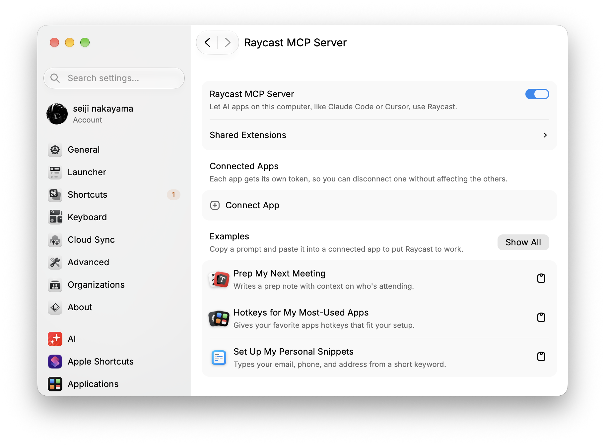
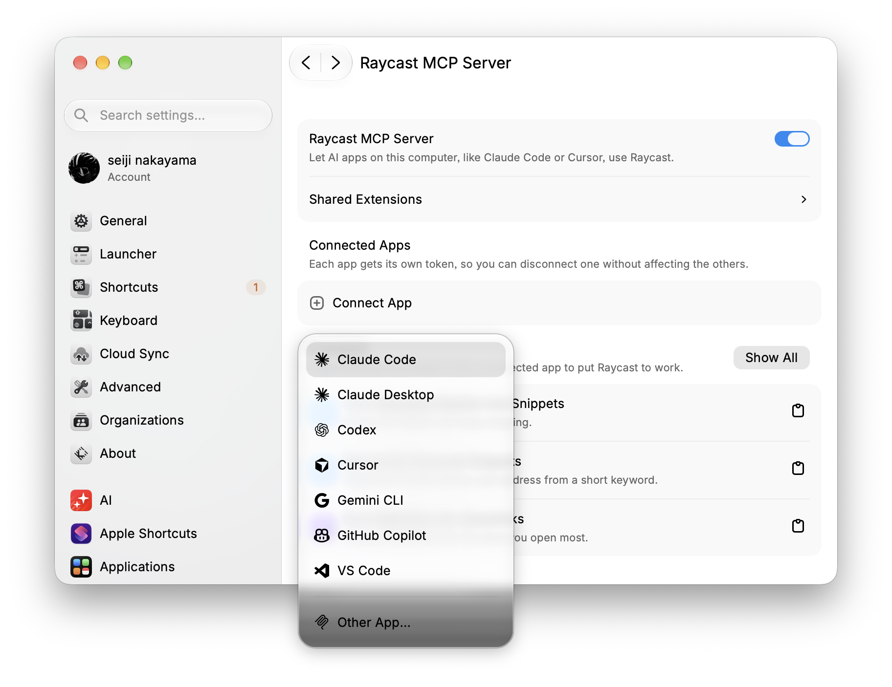

<script src="https://cdn.tailwindcss.com/3.4.4"></script>
<script>tailwind.config = { corePlugins: { preflight: false } }</script>

<style>
:root {
  --color-primary: #ff6362;
}
</style>

<!-- _class: slide-title -->

<div class="title">
  <div>Raycast に Raycast を育ててもらう</div>
</div>
<div class="name">Seiji Nakayama</div>
<div class="date-and-event">2026/11/24 Raycast Meetup Japan #3</div>

---


<style scoped>
.item {
  display: flex;
  align-items: center;
  gap: 0.75em;
}
</style>

<div>
  <h1 class="text-foreground">
    せーじ
    <small class="text-3xl font-bold">(Seiji Nakayama)</small>
  </h1>
  <h5 class="text-dimmed">ただのVimmer</h5>
  <div class="mt-12 space-y-2 text-2xl">
    <div class="item">
      <div class="label">業務</div>
      <span><small>バックエンド・Webの開発(たまにアプリ)</small></span>
    </div>
    <div class="item">
      <div class="label">好き</div>
      <span>
        Raycast・Vim・ロードバイク・車<br />
        <strong>シンプルで拡張性があるプロダクト</strong>
      </span>
    </div>
    <div class="item">
      <div class="label">特徴</div>
      <span>実家が洋菓子店</span>
    </div>
    <div class="item">
      <div class="label">サイト</div>
      <a href="https://sijis.me"><small>HomePage</small></a>
      <a href="https://www.raycast.com/n_seiji"><small>Raycast</small></a>
      <a href="https://github.com/n-seiji"><small>GitHub</small></a>
      <a href="https://x.com/se_eiji"><small>X</small></a>
    </div>
  </div>
</div>

---

## これまでの Raycast の話

| イベント | タイトル |
|---------|---------|
| Raycast Meetup Japan #1(2025/02) | [Raycastを育てよう!](https://n-seiji.github.io/slides/raycast-meet-up-1/) |
| AI dev day(2025/06) | [MCPを利用するインターフェースとしてのRaycastのポテンシャル](https://n-seiji.github.io/slides/ai-dev-day/) |

<div class='mt-8 text-3xl'>

今日はこの 2 つの続き。**育てる** × **MCP**

</div>

---

<!-- _class: full lead narration-white -->

# Raycast MCP Server が来た!

---

<!-- _class: full lead narration-white -->

# Raycast MCP Server が来た!

###### [前回(AI dev day)](https://n-seiji.github.io/slides/ai-dev-day/)は Raycast → MCP。今回は MCP → Raycast

---

## Settings → MCP → Raycast MCP Server

<div class="flex justify-center items-center gap-8">
  
  
</div>

<div class='mt-4 text-2xl'>

ON にして **Connect App** を押すだけ。Claude Code / Codex / Cursor など 7 つにワンクリック

</div>

---

## Claude Code から Raycast が全部見える

| 拡張 | できること(一部) |
|------|-----------------|
| Clipboard | 履歴の検索・ピン留め・削除 |
| Snippets / Quicklinks | 一覧・作成・更新・削除 |
| Calendar / Contacts | 予定の作成・返信、連絡先の更新 |
| Settings | **全設定・全 Hotkey を読んで書き換え** |
| Store / Applications | 拡張のインストール、アプリのアンインストール |
| Manual | **公式マニュアルを検索して読む** |

<div class='mt-4 text-2xl'>

**21 拡張・93 ツール**。Raycast がまさに **ハブ**

</div>

---

## ⚠️ ひとつだけ注意

> Raycast doesn't ask for confirmation when a connected app calls a tool.
> [Raycast Manual - Model Context Protocol](https://manual.raycast.com/ai/model-context-protocol)

- 確認するのは **接続した側**(Claude Code など)
- Raycast は `readOnlyHint` / `destructiveHint` を渡すだけ
- 接続先の承認設定は見直しておこう

---

## 公式 Examples が 16 個ある

| 分類 | Examples |
|------|----------|
| **Raycast を育てる(7)** | Find Extensions for My Apps / Turn Websites into Quicklinks / Hotkeys for My Most-Used Apps / Tune Raycast to How I Work … |
| 片づける(2) | Clean Up Apps I Don't Need / Set Up Auto Quit … |
| 自分を覚えさせる(3) | Teach Raycast About Me / Teach Dictation How I Write … |
| 日々の作業(4) | Prep My Next Meeting / Turn My Tabs into a Note … |

<div class='mt-4 text-2xl'>

Settings → MCP → Raycast MCP Server → **Examples → Show All**

</div>

---

## 試した: Hotkeys for My Most-Used Apps

| 順位 | アプリ | 起動回数 | 提案 |
|------|--------|---------|------|
| 1 | Slack | 410 | Hyper+S は使用中 → スキップ |
| 3 | Google Chrome | 22 | **Hyper+G** |

- **「Hyper + 頭文字」という自分のルール** を見抜き、**Hyper+Space の重複** も発見
- 起動回数は `mdls -name kMDItemUseCount` = **Mac 全体の起動回数**
  - Raycast 経由の回数は **Raycast Wrapped** でしか見られない

###### ただし Spotlight 次第。記録があったのは 11 アプリだけ、、、

---

<!-- _class: full lead narration-white -->

# 一番多いのは「Raycast を育てる」

---

<!-- _class: full lead narration-white -->

# 一番多いのは「Raycast を育てる」

###### でも設定画面の奥にある、英語のコピペ用プロンプト、、、

---

<!-- _class: full lead narration-white -->

# Skill にすれば
# Raycast の中で勝手に動く

---

## Raycast AI の Skills

- `SKILL.md` をフォルダに置くだけ(Agent Skills の形式)
- `~/.claude/skills` や `~/.config/raycast/skills` を **自動で読む**
- 話題に合わせて **勝手に読み込まれる**。`@名前` で明示もできる
- 承認は Raycast AI の Permissions(Auto なら破壊的操作の前に確認)
- **Raycast の中なら MCP なしで同じツールが使える**(MCP Server が公開しているのは組み込みの AI Extensions そのもの)

<div class='mt-4 text-2xl'>

Raycast の中で、Raycast の AI Extensions を使って、**Raycast を育てる**

</div>

---

<!-- _class: grid-5-5 -->

## 使い分け

<div class="left">

### Raycast の中で完結

**Skills**(AI Chat / Quick AI)

- Raycast を育てる・片づける
- 承認は Raycast がやってくれる
- 今日作った `raycast-onboard` はこっち

</div>
<div class="right">

### 外の agent から MCP

**Examples**(Claude Code など)

- 外の agent の知識を Raycast に入れる
- 例: **Teach Raycast About Me**<br>= Claude の memory → Raycast Memory
- 承認は agent 側の設定次第

</div>

---

## 作った: raycast-onboard

| Skill | 話しかけ方 | やること |
|-------|----------|---------|
| `raycast-onboard` | 「オンボーディングして」 | ハンズオン。**「できた」を実データで確認して次へ** |
| `raycast-level` | 「何レベル?」 | 7 観点で採点、🥚 Lv1 〜 🐉 Lv6 の **通信簿** |
| `raycast-growth` | 「育てて」 | Hotkey・Snippet・拡張・設定を **提案して実際に設定** |
| `raycast-tidy` | 「スッキリさせたい」 | Quicklinks / Snippets / Hotkey の **棚卸し** |

```sh
git clone https://github.com/n-seiji/raycast-onboard ~/raycast-onboard
# Settings → AI → Skills → Skill Folders に ~/raycast-onboard/skills を追加
```

---

## raycast-onboard: 「できた」→ 確認 → 次へ

| # | ミッション | AI が確認するもの |
|---|-----------|-----------------|
| 1 | 「らーめん」をコピー → 履歴から貼る | Clipboard の `copyCount` |
| 2 | Clipboard History に Hotkey | 設定の `currentValue` |
| 3 | メールアドレスを Snippet に | Snippets の一覧 |
| 4 | よく見るサイトを Quicklink に | Quicklinks の一覧 |
| 5 | Store で拡張を 1 つ | `installed` |

<div class='mt-4 text-2xl'>

<!-- TODO: デモのスクショに差し替え -->
**自己申告じゃなく、Raycast の状態を見て判定**

</div>

---

## raycast-level: Raycast 通信簿

<!-- TODO: 実際の通信簿のスクショに差し替え -->

```
## 🐥 Lv3 こども(12 / 21)

⌨️ 呼び出し      ■■□  Hotkey 6 個
📋 クリップボード ■■■  よく再利用してる
✂️ Snippets      ■□□  3 個
🔗 Quicklinks    ■■□  8 個
🧩 拡張          ■■■  24 個
...
```

---

## わかったこと

- **Raycast コマンドの使用回数は取れない**(アプリの起動回数は `mdls` で取れるが Spotlight 頼み)
- **AI Commands は名前もプロンプトも読めない**(見えるのは ID と Hotkey だけ)
- ローカルの DB は暗号化されていて直接は読めない

###### AI Commands も MCP で読めるようになってほしい、、、!

---

## AI が読めるドキュメントも揃ってる

- [manual.raycast.com/llms.txt](https://manual.raycast.com/llms.txt)(全文は `llms-full.txt`)
- [manual.raycast.com/ai/model-context-protocol.md](https://manual.raycast.com/ai/model-context-protocol.md)
- そもそも MCP に **`@manual`** が入っている

<div class='mt-4 text-2xl'>

Skill の説明は全部 `@manual` を根拠にさせている。**AI が Raycast を Raycast に聞く**

</div>

---

<!-- _class: full lead narration-white -->

# Raycast を育てるのは<br>Raycast の仕事

---

<!-- _class: full lead narration-white -->

# Raycast を育てるのは<br>Raycast の仕事

###### 育てる楽しみは、ちょっとだけ残しておいてね

---

<!-- _class: slide-last -->

# ご清聴ありがとうございました
